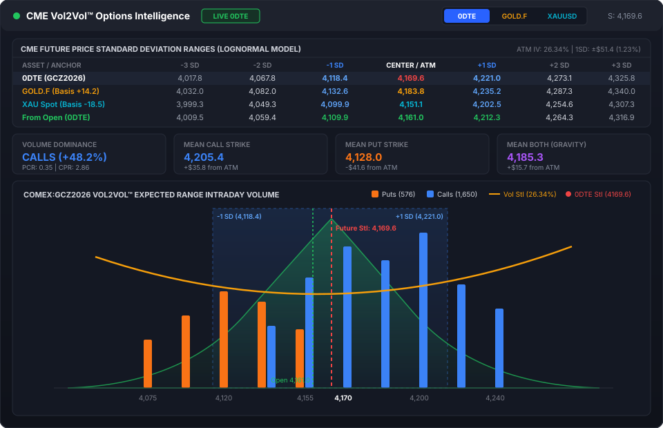
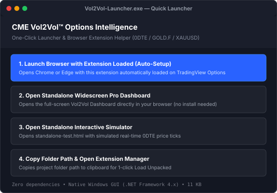
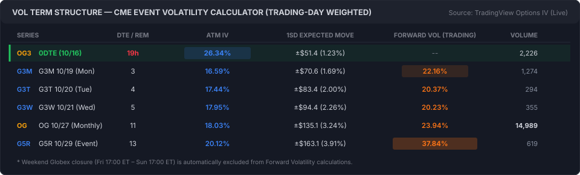
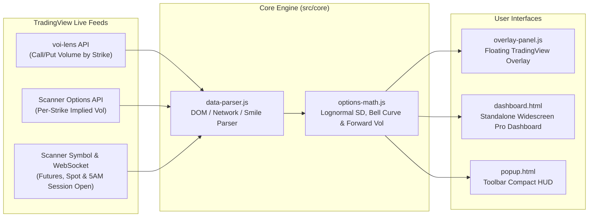

# CME Vol2Vol™ Options Intelligence — TradingView Chrome/Edge Extension


A **Manifest V3 browser extension** for Google Chrome and Microsoft Edge — plus a **one-click Windows `.exe` launcher** — that brings CME QuikStrike-grade options volume, implied volatility, expected move bands, and event volatility term structure directly onto **TradingView Options** (`https://www.tradingview.com/options/*`).



---

## Quick Start for Non-Technical Users (`Vol2Vol-Launcher.exe`)

Don't want to configure browser extension settings manually? Just double-click **`Vol2Vol-Launcher.exe`** in the project root folder:



| Option in `Vol2Vol-Launcher.exe` | What It Does |
|---|---|
| **1. Launch Browser with Extension Loaded (Auto-Setup)** | Automatically launches Chrome or Edge with the extension pre-loaded (`--load-extension`) directly onto TradingView Gold Options. |
| **2. Open Standalone Widescreen Pro Dashboard** | Opens the full-screen Widescreen Pro Dashboard (`src/dashboard/dashboard.html`) immediately in your default browser — **zero installation required**. |
| **3. Open Standalone Interactive Simulator** | Opens `standalone-test.html` with a built-in real-time 0DTE price tick simulator. |
| **4. Copy Folder Path & Open Extension Manager** | Copies the exact folder path to your clipboard so you can paste (`Ctrl+V`) into Chrome/Edge `Load unpacked` in one second. |

---

## Core Features

### 1. Multi-Asset Standard Deviation Ranges (`-3σ` to `+3σ`)
Computes risk-neutral lognormal expected move bands:
$$K_k = S \cdot \exp\left(-\frac{1}{2}\sigma^2 T + k\sigma\sqrt{T}\right)$$

Synchronized across **4 live reference rows**:
- **0DTE Active Delivery Contract** (`COMEX:GCV2026` / `COMEX:GCZ2026`)
- **`BLACKBULL:GOLD.F` Futures** (live basis spread conversion: $\text{Basis} = P_{\text{GOLD.F}} - P_{\text{0DTE}}$)
- **`OANDA:XAUUSD` Spot CFD** (live basis spread conversion: $\text{Basis} = P_{\text{XAUUSD}} - P_{\text{0DTE}}$)
- **From Session Open** (anchored to the **5:00 AM ICT / 18:00 ET CME Globex session open**, dynamically shifted across `0DTE`, `GOLD.F`, and `XAUUSD` perspectives)

---

### 2. CME Event Volatility Calculator / Vol Term Structure
Streams live per-strike Implied Volatility from TradingView's Options Scanner (`scanner.tradingview.com/options/scan`) and computes the complete term structure across upcoming series (`OG`, `G1W`, `G2R`, etc.):



- **Series ATM IV**: Linearly interpolated at each series' own underlying futures forward price ($F$).
- **Exact Time-to-Expiry ($T$)**: Resolved to `16:59:59 America/New_York` (automatic EDT/EST handling).
- **1SD Expected Move**: $\pm\$ = F \cdot \sigma \cdot \sqrt{T}$ and percentage move.
- **Trading-Day Weighted Forward Volatility**:
  $$\sigma_{\text{fwd}} = \sqrt{\frac{\sigma_2^2 T_2 - \sigma_1^2 T_1}{\Delta T_{\text{trading}}}}$$
  Automatically excludes the **48-hour CME Globex weekend closure** (Friday 17:00 ET to Sunday 17:00 ET) so Friday-to-Monday forward volatility reflects true trading-day variance rather than being diluted by non-trading weekend hours. Hover over any Forward Vol cell to inspect both Trading-Day and Calendar-Day values.

---

### 3. Volume Dominance & Volume-Weighted Mean Strikes
- **Call vs. Put Dominance**: Net volume dominance percentage, Put/Call Ratio (PCR), and Call/Put Ratio (CPR).
- **Mean Call Strike**: $\bar{K}_C = \frac{\sum K \cdot V_C}{\sum V_C}$
- **Mean Put Strike**: $\bar{K}_P = \frac{\sum K \cdot V_P}{\sum V_P}$
- **Mean Both (Volume Center of Gravity)**: $\bar{K}_{\text{Both}} = \frac{\sum K \cdot (V_C + V_P)}{\sum (V_C + V_P)}$

---

### 4. Dual-Axis Vol2Vol™ Canvas Chart & Multi-Asset Perspective Shift
- **Left Y-Axis**: Call (blue) and Put (orange) volume bars by strike.
- **Right Y-Axis**: Implied Volatility smile curve (`Vol Stl`).
- **Probability Density Overlay**: Lognormal probability bell curve centered on either Current Price (`Future Stl`) or Session Open (`Open`), with toggleable $\pm 1\sigma$, $\pm 2\sigma$, and $\pm 3\sigma$ shaded bands.
- **1-Click Perspective Shift (`0DTE` | `GOLD.F` | `XAUUSD`)**: Shifts every strike bar, SD band, open line, bell curve peak, and chart legend by the live basis spread with 100% mathematical consistency.

---

## System Architecture



---

## Project Structure

```text
Vol-Strike-Cal/
├── Vol2Vol-Launcher.exe          # 1-Click Windows GUI Launcher (zero dependencies)
├── manifest.json                 # Chrome / Edge Extension Manifest V3
├── standalone-test.html          # Standalone browser preview & realtime tick simulator
├── package.json                  # Test & build scripts
├── LICENSE                       # MIT License
├── docs/images/                  # SVG vector screenshots & diagrams for documentation
├── icons/                        # Extension icons (16x16, 48x48, 128x128)
├── scripts/
│   ├── Launcher.cs               # C# Windows Forms source for Vol2Vol-Launcher.exe
│   └── build-exe.ps1             # PowerShell script to compile Vol2Vol-Launcher.exe
├── src/
│   ├── core/
│   │   ├── options-math.js       # Black-Scholes lognormal SD bands, Vol Smile, Term Structure & Forward Vol
│   │   ├── data-parser.js        # TradingView DOM/network parser, Scanner IV parser, DTE & series resolver
│   │   └── tv-interceptor.js     # MAIN-world fetch/XHR/WebSocket interceptor for voi-lens & real-time ticks
│   ├── ui/
│   │   ├── vol2vol-chart.js      # High-DPI HTML5 Canvas dual-axis chart with perspective shifting
│   │   └── overlay-panel.js      # Draggable floating overlay panel on TradingView
│   ├── content/
│   │   ├── content.js            # Content script orchestrating live data feeds, Scanner IV & storage sync
│   │   └── overlay.css           # Dark/Light theme styling for the floating overlay
│   ├── popup/
│   │   ├── popup.html            # Toolbar popup HUD
│   │   ├── popup.js
│   │   └── popup.css
│   └── dashboard/
│       ├── dashboard.html        # Standalone Widescreen Pro Dashboard
│       ├── dashboard.js
│       └── dashboard.css
└── test/
    ├── run-all.js                # Unified runner for all 10 automated test suites
    └── test-*.js                 # Unit & integration verification suites
```

---

## Manual Extension Installation (Chrome / Edge)

If you prefer to install the browser extension manually without using `Vol2Vol-Launcher.exe`:

1. Open **Google Chrome** (`chrome://extensions`) or **Microsoft Edge** (`edge://extensions`).
2. Enable **Developer mode** (toggle in the top-right corner).
3. Click **Load unpacked** (button in the top-left corner).
4. Select the repository root folder (`Vol-Strike-Cal`).
5. Open [TradingView Gold Options Volume](https://www.tradingview.com/options/volume/?symbol=COMEX%3AGC1%21&tab=by-strike).

---

## Running Tests & Rebuilding the Launcher

Requires [Node.js](https://nodejs.org/) v18+:

```bash
# Run all 10 automated verification suites
npm test

# Probe live TradingView Options Scanner IV & Term Structure
npm run probe:live

# Rebuild Vol2Vol-Launcher.exe from scripts/Launcher.cs (Windows)
npm run build:exe
```

---

## Disclaimer

This project is an independent open-source analytical tool for educational and research purposes. It is **not** affiliated with, endorsed by, or sponsored by CME Group Inc. or TradingView Inc. `CME`, `QuikStrike`, and `Vol2Vol` are trademarks of their respective owners. Nothing in this software constitutes financial or trading advice.
